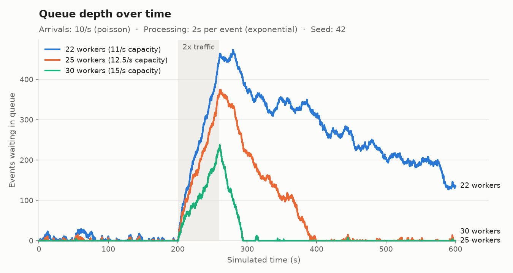

# ArchSim

**Find the bottleneck in your event-driven architecture before your users do.**

ArchSim simulates backend systems built on queues and workers. Describe your workload and capacity, and see in seconds where work piles up, how long jobs wait, and how much headroom you actually need, without deploying anything.



## Why

Capacity decisions are usually guesses: *How many workers do we need? Will the queue back up at peak? If traffic doubles for a minute, how long until we recover?* Architecture diagrams show what exists, not how it behaves under load, and load tests only work once the infrastructure is built. ArchSim makes those questions cheap to answer.

Built for backend engineers sizing worker pools, tech leads checking capacity plans, and anyone building intuition for system design.

## Quickstart

Requires Python 3.11+.

```bash
python -m venv .venv
.venv\Scripts\Activate.ps1        # macOS/Linux: source .venv/bin/activate
pip install -e ".[dev]"

archsim run --rate 10 --workers 5 10 20 --service-time 2 --duration 60 --chart chart.png
```

## Example: recovering from a traffic spike

Jobs arrive at ~10/s and take ~2s each. Traffic doubles for one minute. How many workers do we need?

```
$ archsim run --rate 10 --workers 22 25 30 --service-time 2 --duration 600 \
    --arrivals poisson --service exponential --seed 42 --spike 200:60:2 --chart spike.png

                    22 workers  25 workers  30 workers
------------------------------------------------------
Max queue depth            474         375         238
P50 latency (s)          20.98        3.03        1.98
P95 latency (s)          39.83       26.94       13.21
Utilization               0.97        0.87        0.73
Spike recovery (s)       never      134.02       33.95
```

All three handle normal traffic and all three back up during the spike (the chart above). The difference is **spare capacity** afterwards: 30 workers recover in ~34s, 25 take over two minutes, and 22 are still recovering five minutes later. P95 shows what averages hide: with 25 workers the median job takes 3s, but 1 in 20 takes 27s or more.

A related, less intuitive lesson: with random traffic, capacity that *exactly* matches average demand isn't enough. At 20 workers (100% utilization) the queue swings up to 88 jobs and latency is ~2.5x the processing time; 10-25% headroom mostly eliminates it.

## Options

| Option | Meaning |
|---|---|
| `--rate` | Average arrivals per second |
| `--workers` | One or more worker counts to compare side by side |
| `--service-time` | Average seconds to process one event |
| `--duration` | Simulated seconds |
| `--arrivals` | `constant` (evenly spaced) or `poisson` (random, like real traffic) |
| `--service` | `constant` or `exponential` (random around the average) |
| `--seed` | Reproducible random runs; all configurations share one arrival stream |
| `--spike` | `START:DURATION:MULTIPLIER`, e.g. `200:60:2` (repeatable) |
| `--chart` | Save a queue depth chart (PNG/SVG) |
| `--json` | Save full results, including the timeseries |

Results include throughput, utilization, queue depth, wait time, average and P50/P95/P99 latency, and spike recovery time. ArchSim warns when many events never finished, since latency then understates the real delay.

### Reading the chart

| Shape | Meaning |
|---|---|
| Steady upward slope | Under capacity; the backlog grows forever |
| Flat at zero | Enough capacity (possibly over-provisioned) |
| Spike, then drain | Recovering from a burst; the width is the recovery time |
| Hovering above zero | Near capacity; fragile under any increase |

## How it works

ArchSim is a **discrete-event simulator**: a virtual clock jumps between scheduled events (a job arrives, a job finishes), so an hour of traffic runs in milliseconds. The engine (`src/archsim/engine/`) is independent of the CLI, and components connect through a single `receive(job)` interface so larger topologies can be composed from the same parts. Results are tested against hand-computed answers and queueing theory (M/M/1).

Current simplifications: a single queue and worker pool, FIFO with unlimited capacity, workers that never fail, and spikes as instant step changes.

## Roadmap

- [x] Side-by-side comparison, queue depth chart
- [x] Random traffic, spikes and recovery time, latency percentiles
- [ ] Multi-stage architectures (multiple queues, services, worker pools)
- [ ] Failure modeling: worker outages, retries, dead-letter queues
- [ ] Requirement checks, e.g. "P95 latency under 5s"
- [ ] Web UI and API
- [ ] Architecture recommendations
