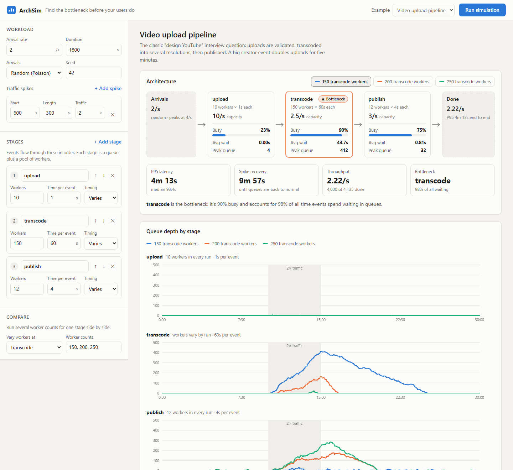
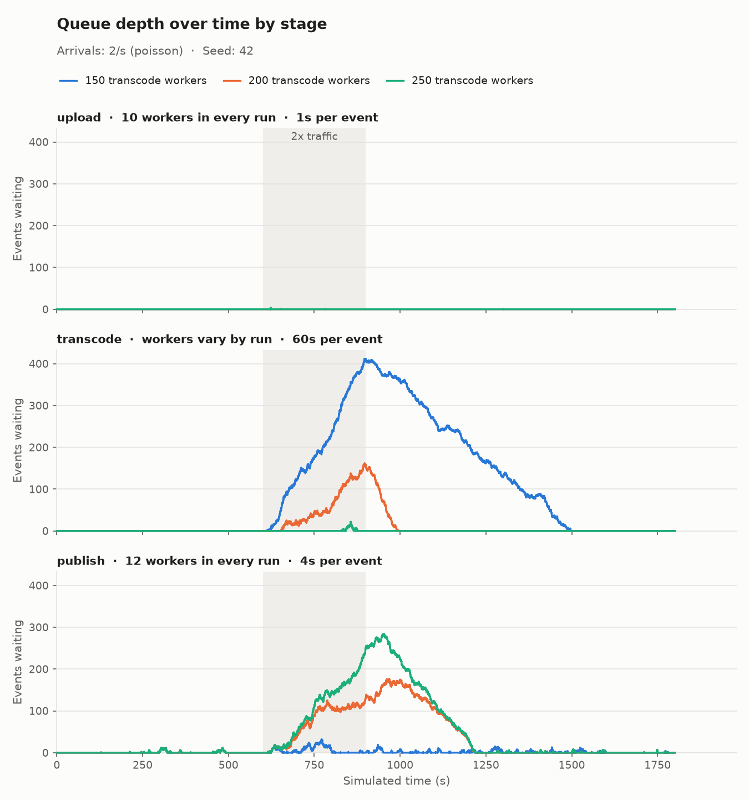

# ArchSim

**Find the bottleneck in your event-driven architecture before your users do.**

ArchSim simulates backend systems built on queues and workers. Describe your architecture and workload in the web UI or a short YAML file, and see in seconds where work piles up, which stage is the bottleneck, and how much capacity you actually need, without deploying anything.



## Why

Capacity decisions are usually guesses: *How many workers do we need? Which service is holding everything up? If traffic doubles for a minute, how long until we recover?* Architecture diagrams show what exists, not how it behaves under load, and load tests only work once the infrastructure is built. ArchSim makes those questions cheap to answer.

Built for backend engineers sizing worker pools, tech leads checking capacity plans, and anyone building intuition for system design.

## Quickstart

Requires Python 3.11+ and Node 18+ (for the web UI).

```bash
python -m venv .venv
.venv\Scripts\Activate.ps1        # macOS/Linux: source .venv/bin/activate
pip install -e ".[dev]"

# Web UI: build once, then serve UI + API at http://localhost:8000
cd web && npm install && npm run build && cd ..
archsim serve

# Or the CLI
archsim run examples/video-upload.yaml --chart chart.png
```

The UI lets you pick an example, edit the workload and stages, compare worker counts, and see the pipeline, bottleneck, and per-stage queue charts update. For frontend development, run `archsim serve --reload` and `npm run dev` (in `web/`) side by side; Vite proxies `/api` to the Python server.

## Describing an architecture

An architecture is a workload flowing through stages in order. Each stage is a queue plus a pool of workers. Here's the upload pipeline from the classic "design YouTube" interview question ([full file](examples/video-upload.yaml)):

```yaml
workload:
  rate: 2               # uploads per second, on average
  arrivals: poisson     # random, like real traffic
  duration: 1800        # 30 minutes
  spikes: [{start: 600, duration: 300, multiplier: 2}]   # a big creator event

stages:
  - name: upload        # validate, virus-scan, store original
    workers: 10
    service_time: 1     # seconds per event, on average
  - name: transcode     # encode into 1080p/720p/480p/...
    workers: 150
    service_time: 60
  - name: publish       # thumbnails, CDN push, notify subscribers
    workers: 12
    service_time: 4
```

Compare variations with `--vary`, e.g. `--vary transcode.workers=150,200,250` or `--vary workload.rate=2,3,4`.

## Example: design YouTube's upload pipeline

Uploads double for five minutes during a big creator event. Transcoding is the obvious bottleneck, so let's add workers:

```
$ archsim run examples/video-upload.yaml --vary transcode.workers=150,200,250

                    150 transcode workers  200 transcode workers  250 transcode workers
---------------------------------------------------------------------------------------
P95 latency (s)                    253.22                 214.07                 214.26
Spike recovery (s)                 597.11                 316.96                 317.00
[transcode]
  Max queue depth                     412                    162                     22
  Utilization                        0.90                   0.67                   0.54
[publish]
  Max queue depth                      32                    177                    284
  Utilization                        0.75                   0.75                   0.75
Bottleneck                      transcode                publish                publish
```

**Scaling transcode helps, then stops helping.** 200 workers halve the recovery time, but 250 change nothing. With 150 workers, transcode was throttling the burst and shielding publish from it. Give transcode more capacity and the burst flows straight through to publish, which becomes the new bottleneck. ArchSim names the bottleneck for every configuration, so you can follow it as it moves.



Scaling **both** stages fixes it: 250 transcode and 16 publish workers cut recovery from 10 minutes to 41 seconds.

**Bonus insight:** P95 latency never drops much below 3 minutes, however many workers you add. Once nothing is waiting, latency is just processing time, and a long video takes a long time to transcode. More workers can't fix that; the architectural fix is to **split each video into chunks and transcode them in parallel**, which is what real video platforms do.

## Quick single-stage runs

For a single queue and worker pool, skip the file and use flags:

```
$ archsim run --rate 10 --workers 22 25 30 --service-time 2 --duration 600 \
    --arrivals poisson --service exponential --seed 42 --spike 200:60:2

                    22 workers  25 workers  30 workers
------------------------------------------------------
P95 latency (s)          39.83       26.94       13.21
Spike recovery (s)       never      134.02       33.95
```

Recovery depends on **spare capacity**: 30 workers recover from the spike in ~34s; 22 are still recovering five minutes later. And with random traffic, capacity that *exactly* matches average demand isn't enough: at 100% utilization, queues swing wildly; 10-25% headroom mostly eliminates them.

## Options

| Option | Meaning |
|---|---|
| `FILE` | Architecture YAML file (see `examples/`) |
| `--vary` | `STAGE.FIELD=V1,V2,...` to compare variations (`workers`, `service_time`, `service`, or `workload.rate`/`duration`/`arrivals`) |
| `--rate`, `--workers`, `--service-time`, `--duration` | Single-stage run without a file (`--workers` takes several values to compare) |
| `--arrivals`, `--service` | Single-stage randomness: `constant`, `poisson` / `exponential` |
| `--seed` | Reproducible random runs; all configurations share one arrival stream |
| `--spike` | `START:DURATION:MULTIPLIER`, e.g. `200:60:2` (repeatable) |
| `--chart` | Save a queue depth chart, one panel per stage (PNG/SVG) |
| `--json` | Save full results, including per-stage timeseries |

Results include end-to-end latency (average, P50/P95/P99), throughput, and spike recovery time, plus per-stage queue depth, wait time, and utilization, and the bottleneck stage. ArchSim warns when many events never finished, since latency then understates the real delay.

### Reading the chart

| Shape | Meaning |
|---|---|
| Steady upward slope | Under capacity; the backlog grows forever |
| Flat at zero | Enough capacity (possibly over-provisioned) |
| Spike, then drain | Recovering from a burst; the width is the recovery time |
| Hovering above zero | Near capacity; fragile under any increase |

## How it works

ArchSim is a **discrete-event simulator**: a virtual clock jumps between scheduled events (a job arrives, a job finishes), so an hour of traffic runs in milliseconds. The engine (`src/archsim/engine/`) is independent of the interfaces: the CLI and a FastAPI server (`src/archsim/api.py`) share the same Pydantic models, and the React + TypeScript UI (`web/`) talks to the API. Every component connects through a single `receive(job)` interface, so stages chain together from the same parts. Results are tested against hand-computed answers and queueing theory (M/M/1).

Current simplifications: stages run in a straight line (no branching), queues are FIFO with unlimited capacity, workers never fail, and spikes are instant step changes.

## Roadmap

- [x] Side-by-side comparison, queue depth chart
- [x] Random traffic, spikes and recovery time, latency percentiles
- [x] Multi-stage pipelines with bottleneck detection
- [ ] Branching architectures (fan-out, routing between services)
- [ ] Failure modeling: worker outages, retries, dead-letter queues
- [ ] Requirement checks, e.g. "P95 latency under 5s"
- [x] Web UI and API
- [ ] Hosted live demo
- [ ] Architecture recommendations
