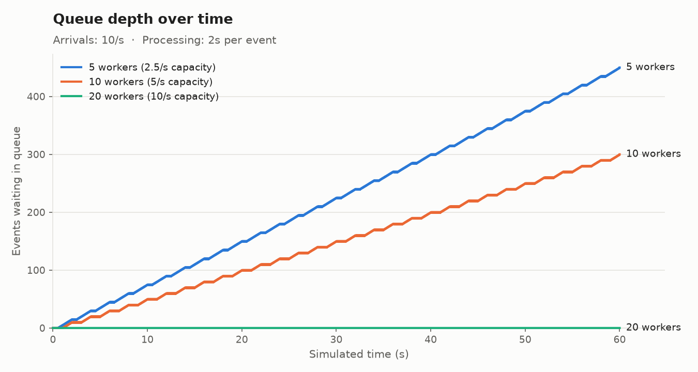

# ArchSim

**Find the bottleneck in your event-driven architecture before your users do.**

ArchSim is a discrete-event simulator for backend systems built on queues and workers. You describe your architecture and workload, and ArchSim shows you how it behaves over time: where work piles up, how long jobs wait, and how much capacity you actually need.

---

## The problem

Architecture decisions are usually made on assumptions:

- *How many workers do we need for this job queue?*
- *Will the queue back up during peak traffic?*
- *If we double traffic, what happens to latency?*

Architecture diagrams show **what** components exist, but not **how they behave under load**. Engineers either guess, over-provision to be safe, or find out in production. Load testing answers these questions, but only after the infrastructure is built.

ArchSim closes that gap: it turns an architecture description into something you can run, measure, and experiment with in seconds, without deploying anything.

## Who it's for

- **Backend engineers** sizing worker pools and background job systems
- **Tech leads** sanity-checking capacity plans before committing to them
- **Students and interview candidates** building intuition for queueing and system design

## Use cases

| Question | How ArchSim answers it |
|---|---|
| "How many workers do I need?" | Compare worker counts side by side and find where the backlog stops growing |
| "Can we handle a 4x traffic increase?" | Rerun with the new arrival rate and see wait time and backlog |
| "Why is latency high when workers are idle?" vs. "Why is it high when they're saturated?" | Utilization and wait time separate *processing* cost from *queueing* cost |
| "What does 'the system can't keep up' actually look like?" | Watch queue depth and latency grow without bound once arrivals exceed capacity |

## What it does today

ArchSim currently models a single pipeline:

```
Producer ──▶ Queue ──▶ Worker Pool ──▶ Done
```

You configure:

- **Arrival rate** (events per second)
- **Worker count** (one or several, for comparison)
- **Processing time** per event
- **Simulation duration**

And get back:

- Events generated, completed, still queued, and in progress
- Average and maximum queue depth (time-weighted)
- Average wait, processing time, and end-to-end latency
- Throughput and worker utilization
- A queue depth chart comparing every configuration (`--chart`, PNG or SVG)
- A full timeseries of queue depth and busy workers (`--json`)

### Example: sizing a worker pool

Jobs arrive at 10/sec and each takes 2 seconds. How many workers do we need?

```
$ archsim run --rate 10 --workers 5 10 20 --service-time 2 --duration 60

                    5 workers  10 workers  20 workers
-----------------------------------------------------
Generated                 600         600         600
Completed                 145         290         580
Still queued              450         300           0
Avg queue depth        222.75      147.25        0.00
Max queue depth           450         300           0
Avg wait (s)            21.75       14.50        0.00
Avg latency (s)         23.00       16.00        2.00
Throughput (/s)          2.42        4.83        9.67
Utilization              0.99        0.99        0.98
```

Add `--chart` to see how the backlog evolves:

```
$ archsim run --rate 10 --workers 5 10 20 --service-time 2 --duration 60 --chart queue-depth.png
```



**Reading the result:** with 5 or 10 workers, utilization is ~100% and the queue grows for the entire run. It never levels off, which means the system will *never* catch up, no matter how long it runs. Latency is dominated by *waiting*, not processing (23s latency for a 2s job). At 20 workers, capacity matches demand: the queue stays empty and latency drops to the bare processing time.

### Reading the queue depth chart

The summary numbers tell you *whether* there's a problem; the chart's shape tells you *what kind*:

| Shape | Meaning |
|---|---|
| Steady upward slope | Under capacity. The backlog grows forever; add capacity or reduce work per event. |
| Flat at zero | Enough capacity. If utilization is also low, you may be over-provisioned. |
| Spike, then drain | A burst the system recovers from. The width of the spike is your recovery time. |
| Hovering above zero | Running near capacity. Works today, but fragile under any increase or variability. |

## Value today

Even in this first version, ArchSim lets you:

1. **Replace guesses with numbers.** Capacity questions get a concrete answer in under a second.
2. **See the cost of under-provisioning.** Not just "it's slow", but *how* slow, how fast the backlog grows, and how many jobs are stuck. The chart makes it visible at a glance, and is easy to drop into a design doc or PR.
3. **Compare options side by side.** Evaluate several configurations in a single command.
4. **Build intuition.** The results make queueing behavior (utilization, backlog, wait vs. processing time) visible and explainable.

## Quickstart

Requires Python 3.11+.

```bash
git clone <repo-url>
cd archsim
python -m venv .venv
.venv\Scripts\Activate.ps1        # Windows PowerShell
# source .venv/bin/activate       # macOS / Linux
pip install -e ".[dev]"

archsim run --rate 10 --workers 5 10 20 --service-time 2 --duration 60
archsim run --rate 10 --workers 5 10 20 --service-time 2 --duration 60 --chart queue-depth.png
archsim run --rate 10 --workers 20 --service-time 2 --duration 60 --json results.json
pytest
```

## How it works

ArchSim uses **discrete-event simulation**. Instead of running real jobs, it keeps a virtual clock and a priority queue of scheduled events (a job arrives, a job finishes). It repeatedly jumps to the next event and updates system state, so an hour of simulated traffic runs in milliseconds.

```
src/archsim/
  engine/        Pure simulation engine (no I/O)
    core.py        Virtual clock + event scheduler
    components.py  Source, Queue, WorkerPool, Sink
    metrics.py     Time-weighted metric recording
  models.py      Config and result schemas (Pydantic)
  charts.py      Queue depth chart (matplotlib)
  runner.py      Builds the architecture from config and runs it
  cli.py         Command-line interface
tests/           Results verified against hand-computed answers
```

Components connect through a single `receive(job)` interface, so more complex topologies (multiple queues and services chained together) can be composed from the same building blocks.

### Current assumptions

The model is deliberately simple. Each assumption will be relaxed over time:

- Constant arrival rate and fixed processing time (no randomness)
- FIFO queue with unlimited capacity
- Workers process one event at a time and never fail
- Single producer, single queue, single worker pool
- No network latency

Because the model is deterministic, a system running at exactly 100% utilization looks stable. In real systems with variable timing it would not be. Modeling that variability is the next step.

## Roadmap

- [x] Single-pipeline simulation with side-by-side comparison
- [x] Queue depth chart
- [ ] Variable arrival and processing times (randomness, traffic spikes)
- [ ] Multi-stage architectures (multiple queues, services, and worker pools)
- [ ] Failure modeling: worker outages, retries, dead-letter queues
- [ ] Requirement checks, e.g. "P95 latency under 5s"
- [ ] Web UI and API
- [ ] Architecture recommendations based on simulation results
